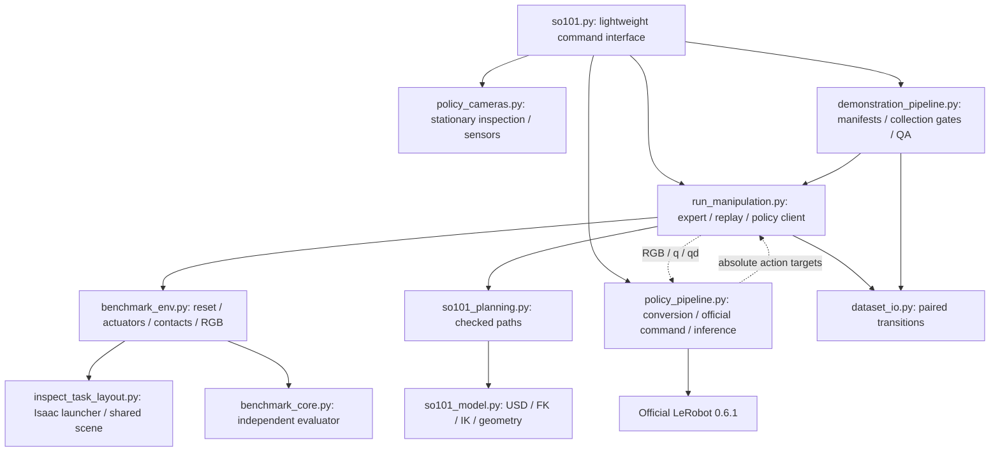

# Code map, outputs and integration

[README](../README.md) · [Simulation/expert](SIMULATION.md#expert-ik-and-motion) · [Data](DATASET.md)

## Runtime relationships



Simulation and learning are separate processes/environments. The expert has
privileged geometry/contact information for planning/control. The future policy
server receives only RGB and q/qd. `TaskEvaluator` reads measured physics and does
not trust expert phase labels; it is shared by expert, replay and learned control.

## Essential runtime and interface files

Paths below are repository-relative; imported modules are APIs, not separate
commands to run. All public data uses metres/radians/seconds unless stated.

| File / classification | Responsibility and inputs → outputs | Entry/use |
| --- | --- | --- |
| [scripts/so101.py](../scripts/so101.py) — interface | Parsed user intent → pinned commands; raw metadata/arrays → inventory and seekable HTML | `python scripts/so101.py --help`; stdlib-only help/preview |
| [scripts/inspect_task_layout.py](../scripts/inspect_task_layout.py) — essential runtime + legacy diagnostic | AppLauncher/assets → shared two-arm table/cube/basket scene; name→joint/body IDs | Imported after launch flags are prepared; direct execution runs old FK motions, not the stationary viewer |
| [scripts/so101_model.py](../scripts/so101_model.py) — essential runtime | Existing USD → joint limits, link/triangle model, FK/IK/TCP and geometric overlap checks | Imported by planner/environment; CPU tests need bundled USD libraries |
| [scripts/so101_planning.py](../scripts/so101_planning.py) — essential runtime | Model, measured joints/payload and target → checked waypoints/diagnostics/cache fingerprints | Expert planning; `--profile` is an offline diagnostic |
| [scripts/benchmark_core.py](../scripts/benchmark_core.py) — essential runtime | Measured `Frame` → independent task result; joint waypoints → spline/timing bounds | Shared evaluator and trajectory mathematics, no Kit |
| [scripts/benchmark_env.py](../scripts/benchmark_env.py) — essential runtime | Absolute position target → physics, contact/state observation and evaluation | Shared reset/20 Hz policy interface; imports after AppLauncher |
| [scripts/run_manipulation.py](../scripts/run_manipulation.py) — essential runtime | Scenarios/plans or policy/replay targets → complete physical attempts and JSON results | `so101.py expert`, `replay`, `evaluate run`; low-level old diagnostics remain for provenance |
| [scripts/policy_cameras.py](../scripts/policy_cameras.py) — essential runtime + maintained diagnostic | Frozen calibration → actual sensor tensors/attachment proofs; saved diagnostics → review figures | `so101.py scene`; imported by environment/QA; historical overview comparison retained |
| [scripts/dataset_io.py](../scripts/dataset_io.py) — essential runtime | Pre-action state/RGB and actual held targets → versioned raw episode; raw files → contract checks | `EpisodeWriter`, `validate_episode`; no Kit/LeRobot |
| [scripts/demonstration_pipeline.py](../scripts/demonstration_pipeline.py) — essential data pipeline | Protocol/approval → fixed manifests and guarded launches; raw/evidence → QA and pilot report | `so101.py collect`, `dataset validate`; low-level `pilot-report` joins existing evidence |
| [scripts/policy_pipeline.py](../scripts/policy_pipeline.py) — essential learning adapter | Accepted raw → official v3; named recipe → official CLI/preflight; checkpoint+RGB/state → actions | `so101.py dataset convert`, `train`, `evaluate serve`; learning environment |

The supported user entry point is `so101.py`. The existing layout module is an
imported scene definition despite its `inspect_task_layout.py` name; keeping its
path preserves runtime/provenance compatibility. The controller and other runtime
modules were not renamed or rewritten for this cleanup.

## Public function map

| API | Inputs → outputs / important boundary |
| --- | --- |
| `SO101Model(asset)`, `.fk(q,base)`, `.tcp_pose(q,base)` | Authored USD and one arm's six radian angles → link transforms /4×4 TCP; explicit base transform |
| `SO101Model.ik(target_m, approach, opening_deg, reference, base, rotation)` | Reachable position/orientation request → distinct converged five-arm-joint solutions and errors; not a safe path |
| `calibrate(model)` | Authored finger triangles → TCP/aperture estimates, mutates `model.tcp`; not physical contact proof |
| `CollisionWorld.check/segment/curve/joint_transit` | Measured configuration, obstacles/payload and margin → faults or checked path; rejects unresolved geometry |
| `plan_pickup/lift/transport/receiver/donor_clearance/placement` | Model and current task state → stage plans; payload/opposite-arm checks as applicable |
| `JointPath(waypoints).position(u)/limits()` | Joint knots + normalized time → quintic-scaled spline targets /nominal derivative bounds |
| `BenchmarkEnv.reset(cube_xy,cube_yaw_deg,seed)` | Initial condition → settled checked state; sole benchmark physical state-write entry point |
| `BenchmarkEnv.advance(action,evaluate)` | `[2,6]` absolute radian targets → one 60 Hz measured `Frame` |
| `BenchmarkEnv.step(action)` | Same target → up to three ticks, nonprivileged observation, terminal flag and independent report |
| `BenchmarkEnv.capture_images/camera_metadata` | Current measured state → three RGB tensors /verified rendered camera/parent poses; no task step |
| `TaskEvaluator.reset/update/report` | Reset check and measured physics frames → stage flags, collision/slip/limit/failure metrics; never expert success labels |
| `Episode.run/move/follow/handover/place` | Checked plans + contact feedback → actuator-controlled full task; state-machine guards supplement independent evaluation |
| `EpisodeWriter.begin/applied/finish` | Pre-action inputs + actual per-tick targets → complete paired raw rows, terminal diagnostics and outcome |
| `make_plan/load_manifest/require_approval/collect` | Fixed protocol + genuine approval → reproducible manifests /counted launch ledger, never a success quota |
| `audit_episode/validate/episode_digest` | Raw bytes + declared case + quality/human records → exhaustive QA and hash-bound acceptance |
| `training_command/parse_official_training/training_dataset_proof/train_official` | Named recipe + accepted train root + optional approval → official config preflight or explicitly authorized official process |
| `convert/serve` | Accepted raw partition /real checkpoint → official dataset /saved-processor policy actions |

## Diagnostics and tests

Only two standalone diagnostics remain maintained. They cover evidence that the
scene viewer and unit tests do not replace:

| File | Purpose / run |
| --- | --- |
| [scripts/audit_so101_finger_geometry_v2.py](../scripts/audit_so101_finger_geometry_v2.py) | Authored USD instance/triangle and jaw-surface audit; `python scripts/audit_so101_finger_geometry_v2.py --offline` |
| [scripts/verify_motion_gripper_reset.py](../scripts/verify_motion_gripper_reset.py) | Deliberate joint/jaw motion and 120 mm cube disturbance followed by measured reset; `python scripts/verify_motion_gripper_reset.py` in the simulation environment |
| [tests/test_benchmark.py](../tests/test_benchmark.py) | Independent stage/failure/reset logic and trajectory/transfer mathematics |
| [tests/test_so101_model.py](../tests/test_so101_model.py) | USD/FK/IK, collision/path/cache and bounded-RRT regressions; requires the existing asset |
| [tests/test_finger_geometry.py](../tests/test_finger_geometry.py) | Analytic triangle sections and prerequisite failures |
| [tests/test_dataset.py](../tests/test_dataset.py) | Held targets, timing, images, terminal transitions and policy/diagnostic isolation |
| [tests/test_policy_cameras.py](../tests/test_policy_cameras.py) | Optical conventions, attachment and continuity-corruption checks |
| [tests/test_demonstration_pipeline.py](../tests/test_demonstration_pipeline.py) | Manifest reproducibility, tamper checks and collection/human/QA gates |
| [tests/test_cli.py](../tests/test_cli.py) | Lightweight help/defaults, replay preview, split labels and training authorization |

## Configurations and other maintained files

| File | Purpose / authority |
| --- | --- |
| [configs/policy_cameras.json](../configs/policy_cameras.json) | Approved, frozen camera calibration; preserve exact bytes |
| [configs/demonstration_protocol.json](../configs/demonstration_protocol.json) | Active provisional sampling/QA design; preserve exact bytes, not an authorization log |
| [configs/policy_training.json](../configs/policy_training.json) | Proposed named `matched-v1` official recipes; no training permission |
| [configs/il_requirements.lock.txt](../configs/il_requirements.lock.txt) | Exact installed learning packages; not an instruction to reinstall |
| [README.md](../README.md) | Single starting point: six ordered operations, status and permissions |
| [AGENTS.md](../AGENTS.md) | Agent contract; directs agents to README rather than a second status document |
| [docs/SIMULATION.md](SIMULATION.md) | Setup reference, USD, cameras, FK/IK, collision paths and physical control/evaluation |
| [docs/DATASET.md](DATASET.md) | Protocol rationale, fields, acceptance, replay, conversion and measured pilot results |
| [docs/POLICIES.md](POLICIES.md) | Official ACT/Diffusion training, checkpointing, inference and fair comparison |
| [docs/ARCHITECTURE.md](ARCHITECTURE.md) | This maintained file/API map, output retention and integration scope |
| [assets/camera_mount/README.md](../assets/camera_mount/README.md), [LICENSE](../assets/camera_mount/LICENSE), [STL](../assets/camera_mount/SO-ARM101_camera_wrist_mount.stl) | Licensed optional mechanical reference; not instantiated as mass/collision geometry |
| [.gitignore](../.gitignore) | Excludes secrets, environments, datasets, weights, generated outputs and caches |
| [.vscode/settings.json](../.vscode/settings.json) | Existing local editor interpreter/package-manager settings |

Historical records are outside the learning sequence:

| Existing record moved into `docs/archive/` | Retained evidence |
| --- | --- |
| [docs/archive/ROBOTICS_CODEX_HANDOFF.md](archive/ROBOTICS_CODEX_HANDOFF.md) | Original dated geometry/control/benchmark development and failures |
| [docs/archive/POLICY_REVIEW.md](archive/POLICY_REVIEW.md) | Earlier failed learning choices, data/camera shortcomings and reasoning |
| [docs/archive/POLICY_REVIEW_METADATA.json](archive/POLICY_REVIEW_METADATA.json) | Byte-preserved machine-readable snapshot; original path strings are historical identifiers |
| [docs/archive/PILOT_RESULTS.md](archive/PILOT_RESULTS.md) | Complete dated 12-attempt table and physical replay results |
| [docs/archive/VERIFICATION.md](archive/VERIFICATION.md) | Measured consolidation regression evidence and this final cleanup's focused checks |
| [docs/archive/REPOSITORY_AUDIT.md](archive/REPOSITORY_AUDIT.md) | Previous inventory and already-completed cache cleanup; its old proposals are superseded by the exact package below |

## Local outputs

`scene` and `expert` need source/configs, the installed environments and external
LeIsaac USD. They do not need old output folders. Research reproducibility does:

| Preserve at its current path | Why |
| --- | --- |
| `datasets/protocol_v1_pilot/` — 12 attempts, 107,454 files, 11,222,342,915 bytes | Original lossless RGB, transitions, captures and independent outcomes; review/conversion hashes depend on these bytes |
| `outputs/protocol_v1_pilot_run/`, `outputs/protocol_v1_pilot_qa/`, `outputs/protocol_v1_pilot_report/`, `outputs/protocol_v1_pilot_replay/` | Actual authorization/attempt counts, exhaustive QA, review media and three physical replay proofs |
| `outputs/demonstration_protocol_v1/` | Exact hash-bound pilot and planned partition manifests |
| `outputs/controller/` — about 357 MB | Reference physical benchmark, transfer traces and checked plans |
| `outputs/camera_v2/`, `outputs/camera_overview_v3/` | Approved framing comparisons and camera attachment/timing evidence |
| `outputs/repository_consolidation/` | Final regression reports, owner-reviewed HTML and diagnostic images/logs; these are evidence, not additional user programs |
| `outputs/policy_traces/` — about 57 MB | Original failed-policy inputs/actions; retained failure evidence, not new training data |
| `outputs/torch/hub/checkpoints/resnet18-f37072fd.pth` — 46.83 MB | Reusable ImageNet backbone, not a trained SO-101 model; keeping it avoids another download |
| Small geometry/model/proposal outputs | Original engineering evidence; no blanket deletion |

The previous cleanup already removed 73 disposable cache/preview files totaling
776,310,957 bytes. Its exact local manifest remains
`outputs/repository_consolidation/cleanup_manifest.json`. This pass does not repeat
or recount that deletion. No byte-identical stationary PNG preview groups were
found. No additional generated evidence is selected for removal. Ordinary Python
bytecode and reader caches may regenerate; their presence does not add maintained
source files. No datasets, checkpoints or evidence folders are in the deletion
package below.

## Focused checks

Choose checks that match the change. Documentation changes need link/anchor,
command-syntax, dependency and preservation checks; do not rerun broad geometry
or physical tasks merely for prose. To check the interface in `leisaac-sim`:

```bash
PYTHONPATH=scripts python -m unittest discover -s tests -p test_cli.py -v
```

For relevant model changes only, use the existing bundled USD libraries:

```bash
USD_LIB="$CONDA_PREFIX/lib/python3.11/site-packages/isaacsim/extscache/omni.usd.libs-1.0.1+69cbf6ad.lx64.r.cp311"
PYTHONPATH="scripts:$USD_LIB" LD_LIBRARY_PATH="$USD_LIB/bin:$CONDA_PREFIX/lib:${LD_LIBRARY_PATH:-}" python -m unittest discover -s tests -p test_so101_model.py -v
```

Use actual independent simulation evaluation for a control/physics change. This
cleanup changes neither. The previous expert/replay regressions and owner-approved
viewer/HTML workflow remain the physical/usability evidence, preserved in the
[verification record](archive/VERIFICATION.md).

## Integration approval

The final content is prepared on `feat/repository-consolidation`; no new branch.
The eight files below stay on disk until the owner's single approval. Their useful
documentation is already consolidated; the unused code/configs are not maintained
interfaces. Git commit `bbb15f5` preserves the complete pre-cleanup tree.

| Exact tracked removal | Dependency check / where its useful content went |
| --- | --- |
| `docs/GETTING_STARTED.md` | README steps 1–3 and SIMULATION environment reference |
| `docs/CONTROLLER.md` | SIMULATION expert equations, contact control and evaluator |
| `docs/DEMONSTRATION_PROTOCOL.md` | DATASET design, randomization, fairness and measured budget |
| `docs/STATUS.md` | README project status is the single current authority |
| `scripts/inspect_fk_frames.py` | No runtime/test/config imports; retire the old standalone FK motion experiment, not an equivalent replacement for every old measurement |
| `scripts/inspect_bimanual_scene.py` | No runtime/test/config imports; retire the old no-basket/gravity sweep; current scene and reset diagnostics remain |
| `configs/camera_v2_pilot.json` | Unused one-pose placeholder; the consumed 12-attempt pilot uses its preserved manifest and active protocol |
| `configs/task_distribution.json` | Unused old 32/8/30 experiment; historical review retains the original identifiers/hash; no active reader |

The retired files remain accessible through [the pre-cleanup Git tree](https://github.com/rynem89/bimanual-so101-benchmark/tree/bbb15f533c186537f81846ac3dc75c6a0a14484e).
The six archive relocations above preserve the existing files rather than adding
new documentation. After the approved eight removals:

| Count (tracked working tree) | Before (`bbb15f5`) | Final prepared tree |
| --- | ---: | ---: |
| All tracked files | 49 | 41 |
| Active guides under `docs/` | 11 | 4 |
| Python source scripts | 15 | 13 |
| Configs, including dependency lock | 6 | 4 |
| Tests | 7 | 7 |
| Historical Markdown records | 2 beside active guides | 5 separated under `docs/archive/` |
| Local /remote branches | 5 /5 | 1 /1 (`main`) |

README, AGENTS and the asset license/README are counted in total files but not in
the four active detailed guides. The archival metadata JSON is a record, not an
active config. Current on-disk total stays 49 until the eight removals are approved.

### Exact final Git operations requiring approval

1. Recheck remote tips and require `main` still at
   `c01651938f6220a23cb19ce3734670376e3eead5`. Stop for changed/divergent tips.
2. Delete only the eight listed files, run focused final-tree checks and commit
   the removals on the existing consolidation branch. Publish that review branch.
3. Fast-forward local `main` to the checked consolidation tip (`git merge --ff-only`),
   then push `main`. No squash, history rewrite or force-push.
4. Only after GitHub `main` is verified at that tip, delete these four branches
   **locally and remotely**: `feat/gripper-characterization`,
   `feat/fingertip-geometry-calibration`, `feat/il-camera-dataset-v2`,
   `feat/repository-consolidation`. All five current tips were verified ancestors
   of the consolidation branch; their commits remain in main's history.
5. Keep all existing recovery tags, pilot data, weights and benchmark evidence.
   The final remaining branch is `main`; no new branch or tag is created.

Approval covers this exact package, not collection, augmentation, training,
new features, dependency changes or any other deletion. If GitHub main protection
blocks the push, stop and report that restriction; do not delete remote feature
branches before integration is verified.
