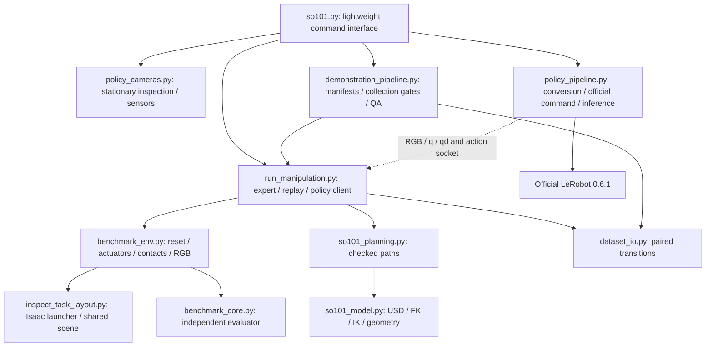

# Architecture and complete file inventory

[README](../README.md) · [Controller](CONTROLLER.md) · [Repository audit](REPOSITORY_AUDIT.md)

## Runtime relationships

Simulation and learning are separate processes/environments. The expert has
privileged geometry/contact information for planning/control. The future policy
server receives only RGB and q/qd. `TaskEvaluator` reads measured physics and does
not trust expert phase labels; it is shared by expert, replay and learned control.

## Essential runtime and interface files

Paths below are repository-relative; imported modules are APIs, not separate
commands to run. All public data uses metres/radians/seconds unless stated.

| File / classification | Responsibility and inputs → outputs | Entry/use |
| --- | --- | --- |
| [scripts/so101.py](../scripts/so101.py) — interface | Parsed user intent → pinned commands; raw metadata/arrays → inventory and seekable HTML | `python scripts/so101.py --help`; stdlib-only help/preview |
| [scripts/inspect_task_layout.py](../scripts/inspect_task_layout.py) — essential runtime + legacy diagnostic | AppLauncher/assets → shared two-arm table/cube/basket scene; name→joint/body IDs | Imported after launch flags are prepared; direct execution runs old FK motions, not the stationary viewer |
| [scripts/so101_model.py](../scripts/so101_model.py) — essential runtime | Existing USD → joint limits, link/triangle model, FK/IK/TCP and geometric overlap checks | Imported by planner/environment; CPU tests need bundled USD libraries |
| [scripts/so101_planning.py](../scripts/so101_planning.py) — essential runtime | Model, measured joints/payload and target → checked waypoints/diagnostics/cache fingerprints | Expert planning; `--profile` is an offline diagnostic |
| [scripts/benchmark_core.py](../scripts/benchmark_core.py) — essential runtime | Measured `Frame` → independent task result; joint waypoints → spline/timing bounds | Shared evaluator and trajectory mathematics, no Kit |
| [scripts/benchmark_env.py](../scripts/benchmark_env.py) — essential runtime | Absolute position target → physics, contact/state observation and evaluation | Shared reset/20 Hz policy interface; imports after AppLauncher |
| [scripts/run_manipulation.py](../scripts/run_manipulation.py) — essential runtime | Scenarios/plans or policy/replay targets → complete physical attempts and JSON results | `so101.py expert`, `replay`, `evaluate run`; low-level old diagnostics remain for provenance |
| [scripts/policy_cameras.py](../scripts/policy_cameras.py) — essential runtime + maintained diagnostic | Frozen calibration → actual sensor tensors/attachment proofs; saved diagnostics → review figures | `so101.py scene`; imported by environment/QA; historical overview comparison retained |
| [scripts/dataset_io.py](../scripts/dataset_io.py) — essential runtime | Pre-action state/RGB and actual held targets → versioned raw episode; raw files → contract checks | `EpisodeWriter`, `validate_episode`; no Kit/LeRobot |
| [scripts/demonstration_pipeline.py](../scripts/demonstration_pipeline.py) — essential data pipeline | Protocol/approval → fixed manifests and guarded launches; raw/evidence → QA and pilot report | `so101.py collect`, `dataset validate`; low-level `pilot-report` joins existing evidence |
| [scripts/policy_pipeline.py](../scripts/policy_pipeline.py) — essential learning adapter | Accepted raw → official v3; named recipe → official CLI/preflight; checkpoint+RGB/state → actions | `so101.py dataset convert`, `train`, `evaluate serve`; learning environment |

`run_manipulation.py` was reviewed (980 lines; largest orchestration functions
`main` 189 lines and `Episode.run` 159 lines). Its algorithm/control code is
intentionally unchanged. Moving live phase logic or removing old flags purely to
shorten the file would introduce regression risk without simplifying the owner's
commands. The new interface provides one supported full-task path; the function
map below and controller guide make the existing phases discoverable. A later
internal extraction should have its own physical regression and approval scope.

## Public function map

| API | Inputs → outputs / important boundary |
| --- | --- |
| `SO101Model(asset)`, `.fk(q,base)`, `.tcp_pose(q,base)` | Authored USD and one arm's six radian angles → link transforms /4×4 TCP; explicit base transform |
| `SO101Model.ik(target_m, approach, opening_deg, reference, base, rotation)` | Reachable position/orientation request → distinct converged five-arm-joint solutions and errors; not a safe path |
| `calibrate(model)` | Authored finger triangles → TCP/aperture estimates, mutates `model.tcp`; not physical contact proof |
| `CollisionWorld.check/segment/curve/joint_transit` | Measured configuration, obstacles/payload and margin → faults or checked path; rejects unresolved geometry |
| `plan_pickup/lift/transport/receiver/donor_clearance/placement` | Model and current task state → stage plans; payload/opposite-arm checks as applicable |
| `JointPath(waypoints).position(u)/limits()` | Joint knots + normalized time → quintic-scaled spline targets /nominal derivative bounds |
| `BenchmarkEnv.reset(cube_xy,cube_yaw_deg,seed)` | Initial condition → settled checked state; sole benchmark physical state-write entry point |
| `BenchmarkEnv.advance(action,evaluate)` | `[2,6]` absolute radian targets → one 60 Hz measured `Frame` |
| `BenchmarkEnv.step(action)` | Same target → up to three ticks, nonprivileged observation, terminal flag and independent report |
| `BenchmarkEnv.capture_images/camera_metadata` | Current measured state → three RGB tensors /verified rendered camera/parent poses; no task step |
| `TaskEvaluator.reset/update/report` | Reset check and measured physics frames → stage flags, collision/slip/limit/failure metrics; never expert success labels |
| `Episode.run/move/follow/handover/place` | Checked plans + contact feedback → actuator-controlled full task; state-machine guards supplement independent evaluation |
| `EpisodeWriter.begin/applied/finish` | Pre-action inputs + actual per-tick targets → complete paired raw rows, terminal diagnostics and outcome |
| `make_plan/load_manifest/require_approval/collect` | Fixed protocol + genuine approval → reproducible manifests /counted launch ledger, never a success quota |
| `audit_episode/validate/episode_digest` | Raw bytes + declared case + quality/human records → exhaustive QA and hash-bound acceptance |
| `training_command/parse_official_training/training_dataset_proof/train_official` | Named recipe + accepted train root + optional approval → official config preflight or explicitly authorized official process |
| `convert/serve` | Accepted raw partition /real checkpoint → official dataset /saved-processor policy actions |

## Diagnostics, tests and historical experiments

| File / classification | Purpose / status |
| --- | --- |
| [scripts/audit_so101_finger_geometry_v2.py](../scripts/audit_so101_finger_geometry_v2.py) — maintained diagnostic | USD instance/collision/triangle audit and jaw sections; `--offline` avoids simulator. Kept because it exposes evidence beyond the viewer. |
| [scripts/verify_motion_gripper_reset.py](../scripts/verify_motion_gripper_reset.py) — maintained diagnostic | Deliberate shoulder/jaw motion and 120 mm cube disturbance followed by measured resets; no grasp control. Its old “not yet verified” printouts describe original scope, not current project status. |
| [scripts/inspect_bimanual_scene.py](../scripts/inspect_bimanual_scene.py) — historical experiment | Older foundation scene and gravity/joint-stability sweeps. It moves robots by default; do not use for current stationary inspection. No active runtime imports. |
| [scripts/inspect_fk_frames.py](../scripts/inspect_fk_frames.py) — historical experiment | Earlier two-arm frame/motion experiment; largely superseded by task layout/model tests. No active runtime imports. |
| [tests/test_benchmark.py](../tests/test_benchmark.py) — test | Independent stage/failure/reset logic, trajectory and transfer math; synthetic evidence, not physics completion |
| [tests/test_so101_model.py](../tests/test_so101_model.py) — test | USD/FK/IK, hull/path/cache and bounded-RRT regression; real asset required |
| [tests/test_finger_geometry.py](../tests/test_finger_geometry.py) — test | Analytic triangle section/prerequisite checks |
| [tests/test_dataset.py](../tests/test_dataset.py) — test | On-disk held-target, timing, bounds, image/terminal transitions and modality isolation |
| [tests/test_policy_cameras.py](../tests/test_policy_cameras.py) — test | Optical conventions/attachments and frame continuity corruption checks |
| [tests/test_demonstration_pipeline.py](../tests/test_demonstration_pipeline.py) — test | Fixed plans, tamper checks, collection/human/QA gates with synthetic files |
| [tests/test_cli.py](../tests/test_cli.py) — test | Lightweight help, validated defaults, replay preview, split labeling, failure inventory and training authorization boundaries |

## Configurations, assets and documentation

| File / classification | Responsibility / authority |
| --- | --- |
| [configs/policy_cameras.json](../configs/policy_cameras.json) — active frozen configuration | Approved three-camera extrinsics, optics, sampling and provenance; do not edit |
| [configs/demonstration_protocol.json](../configs/demonstration_protocol.json) — active provisional configuration | Proposed counts, bounds, sampling, QA thresholds and comparison budget; byte-frozen through review, not an authorization log |
| [configs/policy_training.json](../configs/policy_training.json) — proposed configuration | Named `matched-v1` official CLI recipe; no optimizer implementation or training permission |
| [configs/il_requirements.lock.txt](../configs/il_requirements.lock.txt) — environment record | Exact installed learning packages, not an instruction to reinstall |
| [configs/camera_v2_pilot.json](../configs/camera_v2_pilot.json) — historical configuration | Superseded one-pose camera placeholder; not the consumed 12-attempt pilot |
| [configs/task_distribution.json](../configs/task_distribution.json) — historical configuration | Old inward-v2 32/8/30 cases and offline status; not the current protocol or fresh held-out set |
| [assets/camera_mount/README.md](../assets/camera_mount/README.md), [LICENSE](../assets/camera_mount/LICENSE), [STL](../assets/camera_mount/SO-ARM101_camera_wrist_mount.stl) — reference asset/docs | Licensed optional mount; not physically instantiated/registered |
| [README.md](../README.md) — documentation | Concise project entry and quick start |
| [AGENTS.md](../AGENTS.md) — operating instructions | Agent scope, source authorities, preservation and approval rules |
| [docs/STATUS.md](STATUS.md) — documentation | Sole current-status/permission authority |
| [docs/GETTING_STARTED.md](GETTING_STARTED.md) — documentation | Commands, expected GUI/output and authoritative environment table |
| [docs/SIMULATION.md](SIMULATION.md) — documentation | USD, cameras, optical/frame conventions and hardware gaps |
| [docs/CONTROLLER.md](CONTROLLER.md) — documentation | Actual FK/IK/collision/trajectory/grasp/evaluation implementation |
| [docs/DATASET.md](DATASET.md) — documentation | Raw fields, review, QA, gated collection, replay and conversion |
| [docs/DEMONSTRATION_PROTOCOL.md](DEMONSTRATION_PROTOCOL.md) — documentation | Provisional research design and rationale, with completed-pilot measurements |
| [docs/POLICIES.md](POLICIES.md) — documentation | Official policy recipe, training/resume/inference and unverified limits |
| [docs/ARCHITECTURE.md](ARCHITECTURE.md) — documentation | This complete file/API map |
| [docs/PILOT_RESULTS.md](PILOT_RESULTS.md) — measured results | Curated 12-attempt counts, cases, timings, storage and replay limits |
| [docs/VERIFICATION.md](VERIFICATION.md) — measured results | Consolidation regression commands/results and pending human checkpoint |
| [docs/REPOSITORY_AUDIT.md](REPOSITORY_AUDIT.md) — audit | Branch/file classifications and proposed removals, no deletion authorization |
| [docs/ROBOTICS_CODEX_HANDOFF.md](ROBOTICS_CODEX_HANDOFF.md) — historical archive | Original engineering commands/results and dated failures; no current operating authority |
| [docs/POLICY_REVIEW.md](POLICY_REVIEW.md), [metadata](POLICY_REVIEW_METADATA.json) — historical evidence | Earlier failed learning choices/configuration/provenance; `current_models` means current at that historical audit, not existing models now |
| [.gitignore](../.gitignore) — repository configuration | Excludes outputs, data, weights, caches, environments and secrets |
| [.vscode/settings.json](../.vscode/settings.json) — editor configuration | Existing Conda environment/package manager selection |

## Generated/local files

`datasets/` contains raw data and any later converted copies; `outputs/` contains
reports, plans, screenshots/review media and ignored caches; `checkpoints/` is
currently empty. `logs/`, `runs/`, Python caches and model caches are generated,
not source. Their absence on GitHub is intentional. No unknown tracked file was
silently classified as expendable; all removal proposals are in the audit.
